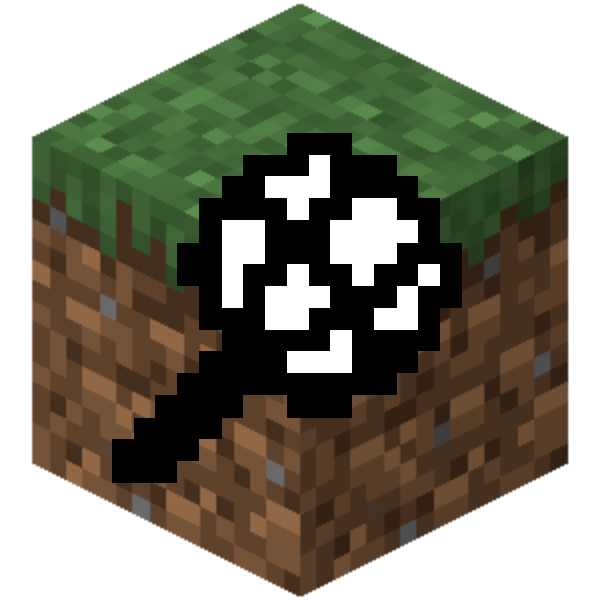

# Blocky Friday

*Funkin' on a Blocky Friday, yeah!*

Play Friday Night Funkin' mods inside Minecraft. Grab a whole FNF mod, drop the folder in, pick up the mic and start funkin'. No converting, no copying charts around. Psych Engine, Codename, the base game and a bunch of their forks just work.

## How it works

Blocky Friday reads FNF mods the way the engines themselves do. It digs through the mod's folders, finds every song with its charts and music, and works out the BPM, scroll speed and everything else from each engine's own files. You never touch any of that.

On a server, only the server needs the mods. When you pick a song, the server sends you the chart and the music. Songs stay downloaded afterwards, so each one only downloads once.

## Features

- Plays mods made for **Psych Engine, Codename Engine, the base game (V-Slice), Kade** and forks like NightmareVision
- Works offline in singleplayer, and on servers for players who don't have the mods
- Psych-style judging: Sick!!, Good, Bad, Shit, combos, accuracy, health and hold notes
- BPM changes and scroll speed changes straight from the charts
- A proper 3, 2, 1, GO! before every song
- **VS mode**: challenge someone with the mic and battle on the same song. You see their notes live, and the higher score wins
- Walk up to someone playing and watch: their arrows float above their head, and you hear the song
- Personal bests and a results screen after every song
- Song menus with search and each mod's own icon
- An FNF camera that shows you from the side, like you're on stage
- Downscroll, middle scroll, showing the opponent, no fail, audio offset and more

## Getting started

1. Install [Fabric](https://fabricmc.net/use/) for **Minecraft 1.21.1** and [Fabric API](https://modrinth.com/mod/fabric-api)
2. Put Blocky Friday in your `mods` folder and start the game once. An `fnfpacks` folder shows up in your `.minecraft` folder (on a server, next to the server jar)
3. Drop FNF mods into `fnfpacks`, one folder each. The whole downloaded mod is fine, `.exe` and all
4. Grab the **Mic** from the Tools & Utilities tab (or `/give @s fnfmod:mic`) and right-click

Play with the arrow keys. You can rebind them, and the camera key (V), under Controls → Blocky Friday. The mic menu also has an Options button.

## VS mode

Right-click another player with the mic, or pick them from **Challenge (VS)** in the mic menu. Once they accept, whoever picks a song first gets to choose it and their side. When it's over you'll see both scores, plus a rematch button if you want revenge.

## Heads up, it's an alpha

- Special notes (hurt notes, mines and so on) count as normal notes, since every mod handles those its own way
- Mod scripts don't run, so no custom events, effects or cutscenes. Just you and the arrows
- Only 4-key charts

Found a song that doesn't load, or something weird? [Open an issue](https://github.com/niliota/fnf-mod/issues).

## Respect the mod creators

Every song you play here was made by someone in the FNF community, and lots of love went into it. Blocky Friday doesn't come with any songs, you bring the mods yourself. So:

- Credit the people who made the mods you play, especially on servers and in videos
- Follow each mod's own rules. If its creators don't want it used outside the game, leave it out
- Never pass someone else's songs, charts or art off as your own

On a server, the songs get sent to everyone who plays them, so server owners: pick your packs with care.

## Credits

Made by niliota.

Friday Night Funkin' is made by The Funkin' Crew. Blocky Friday isn't affiliated with them, and the songs and charts all come from the mods you add yourself.

Copyright (C) 2026 niliota. Licensed under [GPL-3.0-or-later](LICENSE).
